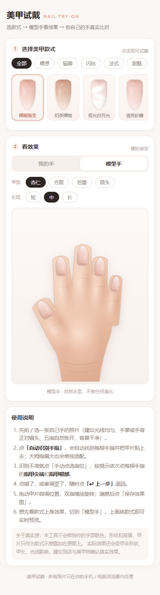

# 美甲试戴 · Nail Try-On（v1）

纯前端的「拍自己的手 → 自动贴甲片 → 看效果挑款式」小站。
手机、平板、电脑都能用，**照片只在本机浏览器里处理，不会上传到任何服务器**。



## 两种打开方式

**① 单文件版（推荐，拷给别人最方便）**

```
美甲试戴-单文件版.html
```

整个网站（HTML + CSS + JS + 全部款式）都在这一个文件里，双击用浏览器打开即可，
直接发微信 / 邮件给别人也能用。改了源码后重新生成：

```bash
node build-single.js
```

**② 源码版（开发用）**

```bash
node server.js        # 启动后终端会打印局域网地址，手机连同一个 Wi-Fi 就能打开
```

或者直接双击 `index.html` 也能跑（不需要任何环境、不需要安装依赖）。

**③ 装到手机桌面，离线也能用（PWA）**

这是纯前端站点，已经内置离线缓存（`manifest.webmanifest` + `sw.js`），
所以只要能通过网址打开一次，就能装成手机 App，之后**没网也能用**：

1. 手机浏览器打开站点地址（局域网 `http://电脑IP:5173`，或部署后的 GitHub Pages 网址）；
2. 等页面完全加载（首次会自动把全部文件缓存到手机）；
3. 安卓 Chrome / Edge：页面顶部会出现 **「安装」**，或菜单里的「安装应用 / 添加到主屏幕」；
   iPhone Safari：点 **分享 ↑ → 添加到主屏幕**；
   微信里打开：点右上角 **⋯ → 在浏览器打开**，再按上面的步骤安装；
4. 之后从桌面图标进入，**飞行模式也能正常拍照、试戴、保存效果图**（照片本来就只在本机处理）。

改了源码后要更新手机上的缓存：把 `sw.js` 里的 `CACHE = 'nail-tryon-v1'`
版本号加一（`v1` → `v2`），手机下次联网打开时会自动换成新版本。

## 部署到 GitHub Pages（一次配置，长期可用）

仓库已经准备好了（含 `.nojekyll`、`sw.js`、`manifest.webmanifest`），推到自己的
GitHub 仓库并开启 Pages 即可，网址形如 `https://<用户名>.github.io/nail-try-on/`。

**用命令行（首次需要登录）：**

```bash
cd D:\ccgpt国内ai中转站\美甲项目
git init -b main
git add .
git commit -m "美甲试戴 v2 + 离线 PWA"
git remote add origin https://github.com/<你的用户名>/nail-try-on.git
git push -u origin main
```

**开启 Pages：** 仓库 → Settings → Pages → Source 选 `Deploy from a branch`，
Branch 选 `main`、目录选 `/ (root)` → Save。等 1 分钟左右，网址就能打开。

也可以用仓库里的脚本一键完成（需要先装 GitHub CLI `gh` 并 `gh auth login`）：

```powershell
pwsh -File .\tools\deploy-pages.ps1 -Repo nail-try-on
```

> 想用私人仓库 + Pages，需要 GitHub Pro；免费账号请把仓库设为 Public。

## 使用流程

1. **打开就是「我的手」**，先拍照或从相册选一张手部照片。
   - 建议：光线均匀、手背或手掌正对镜头、五指自然张开、背景干净。
2. 照片一载入，会自动跑一次 **自动识别手指**：找出每根手指的位置、朝向和粗细，
   按各自的指宽贴甲片（**大拇指偏粗会单独适配**，不会被套成食指的尺寸）。
   识别不理想时点「重新识别手指」。
3. 识别不准就点 **手动点选指位**：按提示依次点每根手指的「指甲尖端」和「指甲根部」，
   或者用「一键铺开」再把甲片拖到对应手指。
4. 点错了、调歪了 → 点 **↩ 上一步** 回退（点选过程中也能一步步退）。
5. 拖动甲片移动，双指缩放旋转；滑杆可以调大小 / 旋转，也能「同步到所有手指」。
6. 满意后点 **保存效果图**，得到原图分辨率的效果图（手机长按保存，电脑点下载）。
7. 只想先看款式上身效果时，切到 **模型手**，上面挑款式即可实时预览，还能切甲型和长短。

## 关于「不美化」

按需求特意做了两件事：

1. 上传的手部照片**不做磨皮、瘦手、调色、塑形**，甲片只作为款式示意叠加在原图上；
2. 模型手走**自然手型**（手指粗细、关节、腕褶都按真人比例画），不是网红手。

页面上也写明了：实际效果会受甲床形状、甲长、光线影响，建议到店与美甲师确认真实效果。

## 甲片的真实感是怎么做的

- 甲面有**弧面明暗**（中间微凸、两侧压暗）+ **镜面亮条**高光，不是一块纯色；
- 叠加时加了**接触阴影**、用附近肤色做**环境色融合**，并在甲根画一层**皮肤褶皱**盖住甲片边缘；
- 所以看起来像长在手上，而不是贴了一张贴纸。

## 文件结构

```
index.html                   页面结构（含 PWA 注册、安装到桌面提示）
manifest.webmanifest          PWA 清单：名称、图标、主题色
sw.js                         离线缓存：首次打开后整个站点存进手机
assets/icons/                 桌面图标（192 / 512 / maskable / iOS 180 / favicon）
assets/css/style.css          样式（移动优先，940px 以上转双栏）
assets/js/nail-art.js         甲片渲染引擎：甲型路径 + 17 款设计图层 + 光泽/立体感
assets/js/hand-detect.js      自动识别手指（肤色分割 + 主轴分析 + 指尖定位 + 指宽测量）
assets/js/hand-model.js       模型手（SVG 手型 + 甲片自动定位）
assets/js/try-on.js           照片试戴（上传 / 识别 / 点选 / 拖动 / 撤销 / 导出）
assets/js/app.js              页面交互与状态
server.js                     本地静态服务器
build-single.js               打包成单文件版
tools/deploy-pages.ps1        一键发布到 GitHub Pages
tools/make-icons.ps1          重新生成桌面图标
preview/                      效果截图
```

没有框架、没有依赖、没有构建步骤（`build-single.js` 只是为了打包）。

## 想加款式 / 改颜色

打开 `assets/js/nail-art.js`，在 `STYLES` 数组里加一条：

```js
{
  id: 'my-style', name: '我的款式', series: 'nude',   // series: nude/cat/shine/french/sweet
  base: [[0, '#e9b7a7'], [0.45, '#f3cec4'], [1, '#fbe8e1']],   // 甲根 → 甲尖 的底色
  layers: [
    { t: 'ombre',   from: 0.5, to: 1, color: '#fff1ea', a: 0.55 },
    { t: 'glitter', n: 30, size: 0.75, color: '#fff2ea', a: 0.42 }
  ],
  finish: 'gloss'      // gloss / matte / soft
}
```

可用的图层（`t` 的值）：

| t | 说明 | 主要参数 |
| --- | --- | --- |
| `ombre` | 渐变 | `from` `to` `color` `a` |
| `french` | 法式甲尖 | `color` `thickness` `bow` |
| `catEye` | 猫眼光带 | `color` `angle` `y` `a` |
| `glitter` | 细闪 / 砂糖 | `n` `size` `colors` `y0` `y1` `a` |
| `foil` | 贝母箔片 | `n` `colors` `span` `a` |
| `aurora` | 珠光光带 | `bands: [{c,a,x,y,rx,ry,rot}]` |
| `plaid` | 手绘格纹 | `color` `lw` `xs` `ys` |
| `dots` / `stars` / `gems` | 波点 / 星星 / 水钻 | `n` `cols` `rows` `size` `color` |
| `line` | 细线 | `shape:'arc'\|'diag'` `y` `lw` `color` |
| `bow` / `flower` / `snowflake` | 蝴蝶结 / 小花 / 雪花 | `x` `y` `size` `color` |
| `marble` | 大理石纹 | `n` `colors` |
| `chrome` | 镜面描边 | `color` `lw` |

甲型在 `SHAPES`（杏仁 / 方圆 / 芭蕾 / 圆头），长短在 `LENGTHS`（短 / 中 / 长，
数值是「长 ÷ 宽」，同时决定照片试戴时甲片比真实指甲长出多少）。

## 自动识别的原理与边界

全在浏览器本地跑，不联网、不上传：

肤色分割 → 取最大连通域（手）→ 主轴方向 + 角度搜索 → 垂直剖面找指尖 →
按各指指宽推算甲面位置与尺寸。

识别失败会自动提示，可以随时改用「手动点选指位」，不会卡住流程。
以下情况识别率会下降，属于正常：

- 背景颜色和肤色接近（暖色木地板、驼色桌布等）；
- 手只露出指尖、或手指互相贴得很紧；
- 强滤镜 / 严重偏色的照片。

## 兼容性

iPhone Safari / 安卓 Chrome / 微信内置浏览器 / 桌面 Chrome、Edge、Safari 均可。
「拍照」按钮会调用系统相机，部分安卓机型会弹「拍照 / 相册」选择框，属正常现象。
